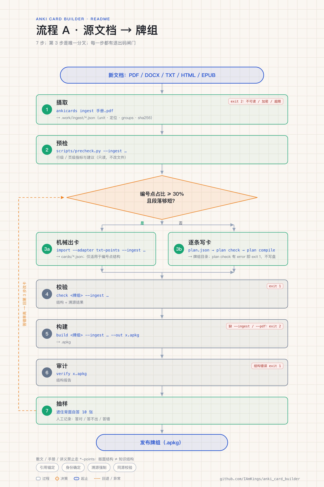
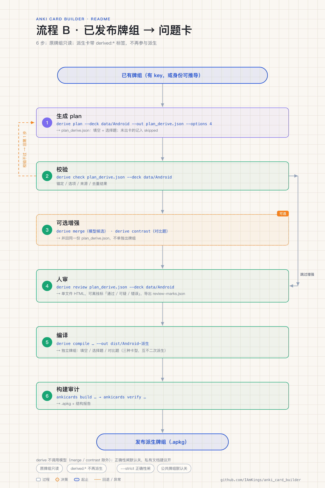

# Anki 卡组生成器

把 PDF / DOCX / TXT / HTML / EPUB 变成**可溯源**的 Anki 卡组：每张卡都带原文定位，答案里的关键信息必须能在引用里逐字找到。仓库同时发布公开牌组，并提供从已发布牌组**派生填空题 / 选择题 / 对比题**的工具链；另附一份可直接安装的 **agent skill**，让 agent 按同一套流程与红线调用这套工具链。

- 公开牌组下载：[Releases](../../releases)
- 宣传页（做得更细的介绍）：<https://iamkings.github.io/anki_card_builder/>
- 工具链入口：`python3 -m ankicards`（`--help` 是命令真值）
- Agent skill（可直接安装）：[`skills/anki-card-builder/SKILL.md`](skills/anki-card-builder/SKILL.md)——流程与判断标准都写在这里
- skill 安装、依赖与更新：[`skills/README.md`](skills/README.md)
- 失败模式与预检阈值：[`docs/extraction-policy.md`](docs/extraction-policy.md)

## 快速开始

### 下载与导入

| 平台 | 做法 |
|---|---|
| Android | 安装 [AnkiDroid](https://github.com/ankidroid/Anki-Android) → 打开 `.apkg` |
| iOS | 安装 AnkiMobile → 打开 `.apkg` |
| 桌面 | 安装 [Anki](https://apps.ankiweb.net/) → 文件 → 导入 |

当前发布：`Android.apkg`（2305 张）、`MQTT.apkg`（308 张）。

> 用微信/QQ 传输时，部分版本会把 `.apkg` 改名成 `apk.1`，AnkiDroid 会提示“不是有效的卡组文件”。把后缀改回 `.apkg` 即可。

### 升级注意

- **0.4.4 及以后 → 最新**：直接导入覆盖，Anki 按 guid 更新，不会重复。
- **从 0.4.3 或更早升级**：先删除 `Android面试::对比题` 子牌组，再导入；对比题在 0.4.4 换了 guid，直接覆盖会残留旧卡。
- **从 0.3.x 升级**：模型与牌组 id 已变化，不能覆盖。备份后删除旧根牌组 `Android面试`、`MQTT协议`（含子牌组）再导入。
- 每个版本的变更与验证记录见 [`CHANGELOG.md`](CHANGELOG.md)。

## 卡组内容

| 牌组 | 张数 |
|---|---|
| Android面试::Java | 196 |
| Android面试::Kotlin | 199 |
| Android面试::综合 | 666 |
| Android面试::阿里巴巴真题 | 84 |
| Android面试::高频题集 | 125 |
| Android面试::填空 | 326 |
| Android面试::选择题 | 651 |
| Android面试::对比题 | 58 |
| **合计** | **2305** |
| MQTT协议::知识 | 200 |
| MQTT协议::填空 | 30 |
| MQTT协议::选择题 | 78 |

覆盖 Java、Kotlin、Android、Compose、Flutter、网络、算法、设计模式、架构与性能。知识卡来自 `data/Android/`、`data/MQTT/` 的题库；填空、选择、对比由工具从知识卡派生，不二次派生。

## 运行流程

两条主流程。先判断目标：

| 目标 | 输入 | 走哪条 |
|---|---|---|
| 新文档 → 新牌组 | 手册、讲义、题库、电子书 | 流程 A |
| 已有牌组 → 问题卡 | 已发布牌组（有 `key`，或可推导） | 流程 B |
| 只看/审计 | 牌组目录、`.apkg` | `check` / `preview` / `verify` |

### 流程 A：源文档 → 牌组



| 步骤 | 命令 | 产物 | 失败时 |
|---|---|---|---|
| 1 摄取 | `ankicards ingest 手册.pdf` | `.work/ingest/*.json`（unit、定位、`groups`、sha256） | exit 2：文件不可读/加密/超限 |
| 2 预检 | `scripts/precheck.py --ingest …` | 行级/页级指标与建议 | 只读，不改文件 |
| 3a 机械出卡 | `ankicards import 源 --adapter txt-points --ingest …` | `cards/*.json` | 仅适用于编号点结构 |
| 3b 逐条写卡 | 写 `plan.json` → `plan check` → `plan compile` | 牌组目录 | `plan check` 有 error 时 exit 1，不写盘 |
| 4 校验 | `ankicards check <牌组> --ingest …` | 结构 + 溯源结果 | exit 1 |
| 5 构建 | `ankicards build <牌组> --ingest … --out x.apkg` | `.apkg` | 缺 `--ingest` 或图片题缺 `--pdf` 时 exit 2 |
| 6 审计 | `ankicards verify x.apkg` | 结构报告 | 结构错误 exit 1 |
| 7 抽样 | 遮住背面自答 10 张 | 人工记录 | 答错率高则回到第 3 步改卡 |

step 3 的选路：编号点占比 ≥ 30% 且段落短，可以试 adapter；否则一律写 `plan.json`。散文、手册、讲义禁止走 `*-points`——版面结构不等于知识结构。

最小命令链（agent 可直接复制）：

```bash
python3 -m ankicards ingest 手册.pdf
python3 scripts/precheck.py --ingest .work/ingest/*.json
# agent 只写 plan.json：每卡带逐字 quote，看过的段落记 skipped
python3 -m ankicards plan check   plan.json --ingest .work/ingest/*.json --min-coverage 0.9
python3 -m ankicards plan compile plan.json --out data/新牌组 --ingest .work/ingest/*.json --with-key
python3 -m ankicards check  data/新牌组 --pdf 手册.pdf --ingest .work/ingest/*.json
python3 -m ankicards build  data/新牌组 --pdf 手册.pdf --ingest .work/ingest/*.json --out dist/新牌组.apkg
python3 -m ankicards verify dist/新牌组.apkg
```

`plan check` 的常用口径：`--profile manual|novel|essay`（引用上限与可用理由）、`--density manual|novel|essay`（字/张）、`--also 另一格式.json`（跨格式逐字对照）、`--min-coverage`（覆盖率下限）。

### 流程 B：已发布牌组 → 问题卡



| 步骤 | 命令 | 产物 |
|---|---|---|
| 1 生成 plan | `ankicards derive plan --deck <牌组> --out plan_derive.json` | 填空 + 选择，未出卡的记 `skipped` |
| 2 校验 | `ankicards derive check plan_derive.json --deck <牌组>` | 锚定/选项/来源/去重结果 |
| 3 可选增强 | `derive merge`（模型候选）、`derive contrast`（对比题） | 并回同一份 plan |
| 4 人审 | `ankicards derive review plan_derive.json --deck <牌组>` | 单文件 HTML，可离线标记 |
| 5 编译 | `ankicards derive compile plan_derive.json --deck <牌组> --out dist/<牌组>-派生` | 独立牌组（填空 / 选择题 / 对比题） |
| 6 构建审计 | `ankicards build …` → `ankicards verify …` | `.apkg` |

```bash
python3 -m ankicards derive plan    --deck data/Android --out plan_derive.json --options 4
python3 -m ankicards derive check   plan_derive.json --deck data/Android
python3 -m ankicards derive review  plan_derive.json --deck data/Android
python3 -m ankicards derive compile plan_derive.json --deck data/Android --out dist/Android-派生
```

约束：原牌组只读；派生卡带 `derived:*` 标签，不再参与派生；`--strict` 打开正确性闸（题干实体锚定、碎片流跳过），私有文档建议开，公共牌组默认关。

### 两条流程的共同约束

- **引用锚定**：卡面信息必须来自 `quote` 或 `locator`，工具只认逐字（忽略空白与千分位）。
- **身份确定**：无 `key` 的问答卡身份是 `(q, a)`，填空卡是 `text`；改一个字就是新卡。发布后不要改身份规则。
- **溯源强制**：引用 `pages` / DOCX / TXT / Web / EPUB 定位的牌组，`check`、`build`、`preview` 都必须带 `--ingest`。
- **同源校验**：同时给 `--pdf/--docx/--txt/--html/--epub` 与 `--ingest` 时比对 `source_sha256`，不一致直接 exit 2。

## Agent skill

仓库根目录的 [`skills/anki-card-builder/`](skills/anki-card-builder/SKILL.md) 是一份可以直接安装的 agent skill。`SKILL.md` 带 YAML frontmatter（`name` / `description`），客户端按 `description` 判断什么时候加载它。

装上之后，agent 拿到的不是一句「帮我做 Anki 卡」，而是本仓库的工作契约：什么时候不该做、先问哪三个问题、哪条路径禁止走、每步做到什么算完成、交付前验什么。确定性的校验仍在 CLI 里，skill 只负责判断与顺序。

### 安装

先准备仓库与依赖（skill 与 CLI 绑定，两种装法都要）：

```bash
git clone https://github.com/IAmKings/anki_card_builder.git
cd anki_card_builder
python3 -m pip install -r requirements.txt          # PDF 截图/裁图另加 requirements-render.txt
python3 -m ankicards --version                      # 写文档时为 0.4.6，以实际输出为准
```

再把 skill 交给 agent，任选一种。

用 [`npx skills add`](https://github.com/vercel-labs/skills)（需要 Node.js ≥ 22.20；默认装到当前项目的 `.agents/skills/`，加 `-g` 装到用户目录、跨项目可用）：

```bash
npx skills add IAmKings/anki_card_builder --skill anki-card-builder -a claude-code -y
```

不带参数运行会交互式选择 skill 与客户端；`-a` 可取值如 `claude-code`、`codex`、`cursor`，完整列表见 `npx skills --help`。升级用 `npx skills update`。

或手动复制（不需要 Node）：目录名必须与 `SKILL.md` 的 `name` 一致，都是 `anki-card-builder`；`~/.agents/skills/` 是示例路径，以客户端文档为准。

```bash
cp -R skills/anki-card-builder ~/.agents/skills/
```

两条路装进去的都只是说明文件，不含 `ankicards` 代码：它依赖本仓库的 `ankicards`、Python 3.12 与 `requirements.txt`，所有命令从仓库根目录运行。完整说明（依赖表、数据安全、更新方式）见 [`skills/README.md`](skills/README.md)。

### skill 里固定了什么

| 部分 | 内容 |
|---|---|
| 触发与边界 | 什么时候该用；什么时候直接拒绝（扫描件、MOBI/AZW、加密文件、需要登录或 JS 渲染的网页） |
| 三条硬性红线 | 散文/手册/讲义禁止走 `*-points` 适配器；agent 不得直接写 `cards/*.json`，只能写带逐字 `quote` 的 `plan.json`；已发布牌组不重跑抽取 |
| 准入 | 先问清用途、验收方式、是否防剧透；四条停问红线：用途缺失、形态与用途冲突、覆盖率异常、抽样失败率 >30% |
| 路径与卡型 | 先判文档形态再选路径；五种抽取卡型（`claim` / `style` / `phrase` / `fact` / `procedure`），三档密度（`manual` / `novel` / `essay`） |
| 工作流 | 确认输入 → 可卡性预检 → 出定位 → 写卡 → 裁图自检 → `check` / `build` / `verify` → 事实校对，每一步都写了完成标准 |
| 交付验收 | `check` / `verify` 0 error、连续两次构建身份一致、抽样自答 10 张、事实校对基准可复述 |

### 边界

- 装 skill 不会让工具多出能力：支持范围与限制仍以 [`docs/extraction-policy.md`](docs/extraction-policy.md) 和 `python3 -m ankicards --help` 为准。
- 不做 OCR、不破加密、不抓需要登录或 JS 渲染的页面；也不承诺把任意散文零判断地抽成卡。
- 升级仓库后，用最新的 `skills/anki-card-builder/` 覆盖旧副本——skill 与 CLI 绑定，不要留旧版本。

## 命令参考

| 命令 | 用途 |
|---|---|
| `ingest` | PDF/DOCX/TXT/HTML/URL/EPUB → 可寻址文本清单（含 `groups`） |
| `import` | 编号点结构 → `cards/*.json`（`--ingest` 时按组出卡） |
| `plan check` | 校验 `plan.json`：引文、数字、定位、理由、覆盖率、卡型、密度、跨格式、剧透 |
| `plan compile` | 校验通过后写牌组；`--incremental` 只补新卡，`--with-key` 生成稳定 key |
| `plan diff` | 对比 plan 与现有牌组的内容差异 |
| `derive plan` | 从已发布牌组生成填空/选择 plan（不调用模型；`--strict`） |
| `derive check` / `compile` | 校验 / 写出派生牌组 |
| `derive merge` / `contrast` | 并入模型候选 / 生成对比题候选 |
| `derive review` / `report` / `packet` | 复核页 / 终端逐条审 / 导出模型素材包 |
| `check` | 只校验卡片数据与溯源，不打包 |
| `build` | 构建 `.apkg`（`--lite` 去掉媒体） |
| `preview` | 单文件 HTML 预览，同样过闸门 |
| `verify` | 导出后结构审计 |

## 数据契约

### 牌组目录

```
data/某牌组/
├── deck.json          # {"name": "...", "source_kind": "pdf|docx|md|txt|web|epub|image|unknown"}
├── cards/01.json      # {"deck": "子牌组名", "cards": [...]}
├── cards/02.json
├── crops.json         # 可选：图片裁切
└── plan.json          # 可选：抽取契约；load_spec 不读取
```

卡片字段：`type`（`qa` / `image` / `cloze`）、`q`、`a`、`text`、`extra`、`pages`、`source`、`tags`、`img`、`key`（可选，12 位十六进制）。

- `source` 是 DOCX/TXT/Web/EPUB 定位，如 `para:12`、`line:3-7`、`block:9`、`chapter:2/p:14`；PDF 用 `pages:[N]` 或 `pages:[N,M]`。
- `key` 存在时身份就是 key；没有时按问答/填空内容算。`guid = sha1(seed)[:12]`。

### plan.json

```json
{
  "version": 1,
  "deck": {"name": "某牌组", "source_kind": "pdf"},
  "cards": [{"locator": "page:12", "quote": "原文里逐字存在的一句", "q": "问什么？", "a": "答什么。", "kind": "fact"}],
  "skipped": [{"locator": "page:1", "reason": "out_of_scope"}]
}
```

| 规则 | 检查 |
|---|---|
| E1 引文 | `quote` 必须是定位文本的逐字子串（忽略全部空白） |
| E2 数字 | 答案里的每个数字都要在 `quote` 中找到（中文数字按数值比对） |
| E3 长度 | `quote` 8–300 字（novel/essay 放宽到 800） |
| E4 定位 | locator 必须在 ingest 产物中存在且有文本 |
| E5 理由 | `reason` 属于枚举；条目区间不得相交，同一定位可多卡但 quote 不得重叠 |
| E6 覆盖率 | 被条目覆盖的组 / 总组，低于 `--min-coverage` 报 error |
| E7 专名 | 卡面 ASCII 标识符既不在 quote 也不在全文 → warning |
| E8 卡型 | `kind` 属于 claim/style/phrase/fact/procedure；各型有额外检查 |

`skipped.reason` 的机械档位：`blank`、`heading`、`not_point`、`continuation`、`table_header`、`duplicate_input`；语义档位：`step_not_concept`、`cross_reference`、`merged_into`、`low_value`、`out_of_scope`、`unreadable`；novel 另有 `plot_summary`、`spoiler`、`character_note`，essay 另有 `anecdote`、`style_note`、`background`。

## 格式与限制

| 格式 | 支持 | 定位 | 限制 |
|---|---|---|---|
| PDF | 文本型 | `page:N`、`page:N-M` | 不做 OCR；扫描件无文本 |
| DOCX | 是 | `para:N`、`table:T/rR` | ≤20MB，解压 ≤200MB，≤5000 块 |
| TXT | 是 | `line:N`、`line:N-M` | ≤10MB，≤50000 行 |
| HTML / URL | 是 | `block:N` | 5MB、5000 块、20s 超时、5 次跳转 |
| EPUB | 是 | `chapter:C/p:M` | 图片型/漫画无文本 |
| MOBI / AZW | 否 | — | 先用 Calibre 转 EPUB |

## 质量与验收

- **确定性规则**：`quality.py` 的 Q1–Q9（答案过短、截断、交叉引用、版面词当正面、正反重复、过长、表头当数据、一卡多点、结尾不完整）在 `import`/`plan compile` 时自动跑。
- **严格模式**：`derive plan --strict` 额外做题干实体锚定、碎片流跳过；公共牌组默认关闭，避免误杀。
- **人工复核**：`derive review` 生成离线 HTML，支持筛选、标「通过/可疑/错误」并导出 `review-marks.json`。
- **抽样**：发布前遮住背面自答 10 张，记录答对/答不出/答错；散文类还要能指回原文具体一句。
- **退出码**：`0` 成功；`1` 数据或闸门失败；`2` 用法或环境错误（坏 JSON、加密 PDF、缺 `--ingest`、拒绝覆盖等）。

## 开发与发布

需要 Python 3.12 与 `requirements.txt`（PDF 截图另装 `requirements-render.txt`）。

```bash
python3 -m unittest discover -s tests -v          # 单元测试
python3 scripts/build_public_decks.py --out dist --check-golden   # 重建并校验公开牌组身份
python3 scripts/apkg_identity.py old.apkg new.apkg               # 排查两个包为何不兼容
```

- `tests/golden/public_decks.json` 固定公开牌组的 guid / 模型 / 牌组身份；有意改内容才用 `--write-golden` 更新，并在提交里说明。
- push/PR 跑 `Verify card decks`（测试、已入库 apkg 审计、golden）；`v*` tag 跑 `Release Anki APKG`（从 tag 源码重建并上传）。
- 发布版本只从 tag 重建，不再上传历史 `output/*.apkg`。

```
ankicards/        # schema（契约）、build、verify、preview、ingest、epub、grouping、precheck、quality、plan、derive、review、adapters、cli
skills/           # 可安装的 agent skill（SKILL.md + 安装说明）
scripts/          # precheck、semantic_map、发布与身份核对
tests/            # 契约、规则、发布身份回归
data/Android/     # 公开题库（MD）与派生输入 contrast.json
data/MQTT/
```

新增题库：优先写 `plan.json`（内容型）或加一个适配器（结构化题库）；不要复制打包逻辑。需要真实相机/PDF 才能复现的牌组，同时加合成 fixture，否则 CI 无法回归。

## License

MIT
